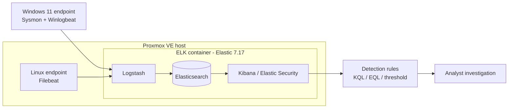

# SOC Detection Engineering: KQL, EQL, and Alert Noise Reduction

Hands-on SOC detection engineering lab featuring KQL threat hunting, EQL behavioral
detections, alert tuning, false-positive reduction, and MITRE ATT&CK validation using
Elastic Security.

> **Project state (2026-11-15): initialized, no exercises run yet.**
> The repository contains the lab documentation, eight KQL hunts, six draft detections, a
> tuning experiment plan, and the tooling to measure results. Every query and rule is an
> untested draft, there are no screenshots, and there are no measured results. Nothing here
> is presented as completed work unless it says "Verified" with its evidence.
> Current status and blockers: [PROJECT_STATUS.md](PROJECT_STATUS.md).

## Contents

1. [Project overview](#1-project-overview)
2. [Architecture](#2-architecture)
3. [Technology stack](#3-technology-stack)
4. [Lab setup](#4-lab-setup)
5. [KQL exercises](#5-kql-exercises)
6. [EQL exercises](#6-eql-exercises)
7. [Alert tuning](#7-alert-tuning)
8. [MITRE ATT&CK mapping](#8-mitre-attck-mapping)
9. [Investigation case studies](#9-investigation-case-studies)
10. [Key findings](#10-key-findings)
11. [Future development](#11-future-development)

## 1. Project overview

This project simulates SOC detection engineering work in a home lab built on Proxmox VE:
collecting endpoint telemetry, hunting through it, writing detections, and then doing the
part that takes most of a detection engineer's time, which is making those detections quiet
enough to be useful without making them blind.

Goals:

- Develop practical KQL querying skills.
- Write behavioral EQL detections.
- Investigate Windows and Linux telemetry.
- Create custom Elastic Security detection rules.
- Identify false positives.
- Tune rules to reduce alert noise.
- Measure precision and recall against a ground-truth record.
- Validate detections through controlled, benign simulations.
- Document investigations and lessons learned.

Working rules for this repository: results are only recorded from labeled data, screenshots
are only authentic captures from the lab, and a rule firing is treated as a pattern match,
not as proof of an attack.

## 2. Architecture

**Proposed architecture, partially verified.** The endpoint side was confirmed on
2026-11-15; the ELK side was unreachable that day and is documented from lab configuration.
Details and the full verification table are in
[docs/01-lab-architecture.md](docs/01-lab-architecture.md).



The original plan called for Elastic Agent. The lab that exists ships with Beats
(Winlogbeat on Windows, Filebeat on Linux) through Logstash, so that is what is documented.
The lab guests currently share the home LAN bridge and are not network-isolated; isolation
is a planned change.

Screenshot pending: Proxmox guest inventory (`screenshots/architecture/01-proxmox-inventory.png`).

## 3. Technology stack

| Technology | Purpose |
|---|---|
| Proxmox VE | Virtualization |
| Windows 11 | Endpoint telemetry |
| Linux (LXC container; Ubuntu VM planned) | Linux telemetry |
| Sysmon | Windows process monitoring |
| Winlogbeat / Filebeat (Elastic Agent planned) | Event collection |
| Logstash | Event routing |
| Elasticsearch | Event storage and search |
| Kibana | Investigation interface |
| Elastic Security | SIEM and detection rules |
| KQL | Event filtering |
| EQL | Event sequence correlation |
| MITRE ATT&CK | Detection classification |

## 4. Lab setup

Steps in the order they are performed. "Verified" means checked directly, with the evidence
in [docs/01-lab-architecture.md](docs/01-lab-architecture.md#verification-state). Everything
else is not yet confirmed for this project.

| # | Step | How | State |
|---|---|---|---|
| 1 | Create the guests | ELK and Linux endpoint as Proxmox LXC containers; Windows 11 endpoint on the LAN | Not verified (Proxmox not inspected) |
| 2 | Configure network isolation | Move lab guests to a dedicated bridge or VLAN with no route to the home LAN | **Not done.** Guests share the LAN bridge |
| 3 | Install Elastic components | Elasticsearch, Logstash, Kibana 7.17.26 via Docker Compose in the ELK container | Configuration exists; stack unreachable on 2026-11-15 |
| 4 | Enroll endpoint shippers | Winlogbeat service on Windows with `output.logstash`; Filebeat on Linux | Windows: service running (Verified), delivery failing. Linux: not verified |
| 5 | Configure Sysmon | `sysmon64.exe -accepteula -i sysmonconfig.xml` (SwiftOnSecurity config) | Service running (Verified) |
| 6 | Validate Windows event ingestion | `GET winlogbeat-*/_count`, then inspect a Sysmon Event ID 1 document | Pending |
| 7 | Validate Linux event ingestion | Discover on `filebeat-*`: `event.dataset: "system.auth"` | Pending |
| 8 | Access Kibana Discover | `http://<ELK_LXC_IP>:5602`, create `winlogbeat-*` and `filebeat-*` index patterns | Pending |
| 9 | Create a detection rule | Security, Rules, Create new rule; start with DET-001 | Blocked, see below |
| 10 | Verify alert generation | Run the DET-001 simulation and confirm an alert | Pending |

Telemetry configuration, the gaps found in it, and the validation checklist are in
[docs/02-telemetry-configuration.md](docs/02-telemetry-configuration.md).

**Blocker for steps 9 and 10:** the Elastic Security detection engine in 7.17 requires
Elasticsearch security to be enabled and a Kibana saved-objects encryption key. The lab
stack runs with neither. KQL hunting and EQL searches through the API do not need this;
creating detection rules does.

Screenshots pending: `02-elastic-dashboard.png`, `03-agent-enrollment.png`, `04-windows-logs.png`.

## 5. KQL exercises

Eight hunting exercises. Each has an objective, query, required ECS fields, expected results,
screenshot slot, investigation questions, limitations, and status in
[docs/03-kql-fundamentals.md](docs/03-kql-fundamentals.md). Queries are saved in
[detection-rules/kql/](detection-rules/kql/).

| ID | Exercise | Data | Status |
|---|---|---|---|
| KQL-01 | Failed Windows logins | Security 4625 | Not started, untested |
| KQL-02 | Successful Windows logins | Security 4624 | Not started, untested |
| KQL-03 | PowerShell execution | Sysmon 1 | Not started, untested |
| KQL-04 | Suspicious command-line arguments | Sysmon 1 | Not started, untested |
| KQL-05 | Unusual process activity | Sysmon 1 | Not started, untested |
| KQL-06 | Network connections | Sysmon 3 | Not started, untested |
| KQL-07 | Linux authentication failures | Filebeat system module | Not started, untested |
| KQL-08 | Administrative account activity | Security 4672, 47xx | Not started, untested |

Example (KQL-01):

```
event.provider: "Microsoft-Windows-Security-Auditing" and event.code: "4625"
```

Screenshots pending: `05-kql-failed-logins.png`, `06-kql-powershell.png`.

## 6. EQL exercises

KQL filters individual documents. EQL matches events by category and can require several
events to occur in order, on the same entity, within a time span. A sequence looks like this:

```
sequence by host.name, user.name with maxspan=5m
  [authentication where event.code == "4625"]
  [authentication where event.code == "4625"]
  [authentication where event.code == "4625"]
  [authentication where event.code == "4624"]
```

Each bracket is one event; the events must occur in that order, share the `by` values, and
fit inside `maxspan`. They do not have to be adjacent. Full explanation and all rules:
[docs/04-eql-detection-engineering.md](docs/04-eql-detection-engineering.md).

| ID | Exercise | Type | Status |
|---|---|---|---|
| [DET-002](docs/detections/DET-002-office-spawns-shell.md) | Office application spawning PowerShell | Event | Untested |
| [DET-003](docs/detections/DET-003-auth-failures-then-success.md) | Authentication failures followed by success | Sequence | Untested |
| [DET-004](docs/detections/DET-004-powershell-then-network.md) | PowerShell execution followed by network activity | Sequence | Untested |
| [DET-005](docs/detections/DET-005-script-host-spawns-shell.md) | Suspicious process ancestry | Event | Untested |
| [DET-006](docs/detections/DET-006-discovery-burst.md) | Correlated activity on a single host | Sequence | Untested |

"Untested" means the syntax follows the Elasticsearch 7.17 EQL reference but has not been
run. EQL also depends on `event.category`, which the current Winlogbeat configuration
probably does not produce; see [docs/02](docs/02-telemetry-configuration.md).

Screenshots pending: `07-eql-rule.png`, `08-eql-alert.png`.

## 7. Alert tuning

**Baseline → Collect alerts → Label results → Identify noise → Tune rule → Retest → Compare metrics**

The method, the definitions used (true and false positives, false negatives, precision,
recall, threshold tuning, rule exceptions, alert suppression, risk scoring, detection
coverage regression), and the first experiment are in
[docs/05-alert-tuning.md](docs/05-alert-tuning.md).

**Experiment DET-001: Reducing Authentication Alert Noise Without Losing Detection Coverage.**
Five stages against a threshold rule on failed logons: baseline, threshold adjustment, a
narrow exception, alert suppression, and a regression test. Simulated activity uses
dedicated local test accounts on the lab endpoint and is logged to a ground-truth file so
that false negatives can be counted.

| Metric | Baseline | Tuned |
|---|---|---|
| Total alerts | Pending | Pending |
| True positives | Pending | Pending |
| False positives | Pending | Pending |
| False negatives | Pending | Pending |
| Precision | Pending | Pending |
| Recall | Pending | Pending |

Values are filled in only from `scripts/calc_metrics.py` run on committed, labeled data.
Stage detail: [results/metrics/DET-001-results.md](results/metrics/DET-001-results.md).

Screenshots pending: `09-baseline-alerts.png`, `10-tuned-alerts.png`, `12-detection-metrics.png`.

## 8. MITRE ATT&CK mapping

A mapping states which technique a detection's observable is consistent with. It is a
classification of the behavior the rule looks for, not a claim that the technique was used:
that is decided per alert, from evidence.

| Detection | Technique | Observed behavior that justifies the mapping |
|---|---|---|
| DET-001 | T1110.001 Brute Force: Password Guessing | Repeated failed logons for one account on one host |
| DET-002 | T1566.001 Spearphishing Attachment; T1204.002 Malicious File; T1059.001 PowerShell | A document-handling application is the parent of a command interpreter |
| DET-003 | T1110.001 Password Guessing; T1078 Valid Accounts | Failed logons followed by a successful logon for the same account |
| DET-004 | T1059.001 PowerShell; T1105 Ingress Tool Transfer | A PowerShell instance connects to a non-private address shortly after starting |
| DET-005 | T1218 System Binary Proxy Execution (.005 Mshta, .010 Regsvr32, .011 Rundll32); T1059.005 Visual Basic | A signed script host or proxy binary is the parent of a shell |
| DET-006 | T1033 System Owner/User Discovery; T1087 Account Discovery; T1016 System Network Configuration Discovery; T1082 System Information Discovery | Several discovery utilities run in order by one user within two minutes |
| KQL-04 | T1027 Obfuscated Files or Information; T1059.001 PowerShell | Encoded or download-related arguments on a command line |
| KQL-07 | T1110.001 Password Guessing; T1021.004 Remote Services: SSH | Failed SSH authentication on the Linux endpoint |
| KQL-08 | T1078.003 Valid Accounts: Local Accounts; T1136.001 Create Account: Local Account; T1098 Account Manipulation | Privileged logons, account creation, and group membership changes |

## 9. Investigation case studies

No investigation has been performed. Each case gets its own report, written from the
[investigation template](templates/investigation-template.md), covering: incident summary,
detection source, event timeline, supporting evidence, analyst findings, MITRE mapping,
response recommendations, rule improvements, and lessons learned.

| Case | Subject | Status |
|---|---|---|
| [SOC-001](investigations/SOC-001-authentication/README.md) | Repeated authentication failures | Not started |
| [SOC-002](investigations/SOC-002-powershell/README.md) | PowerShell with external network activity | Not started |
| [SOC-003](investigations/SOC-003-process-chain/README.md) | Suspicious process ancestry and discovery | Not started |
| [SOC-004](investigations/SOC-004-linux-authentication/README.md) | Linux authentication failures | Not started |

Screenshot pending: `11-detection-timeline.png`.

## 10. Key findings

**Pending results.** No experiment has been completed, so there are no findings about alert
volume, detection quality, or analyst workload to report.

What exists so far are configuration observations made while preparing the lab, recorded in
[docs/07-lessons-learned.md](docs/07-lessons-learned.md). The main one: the Windows sensor's
services were running while delivery to Logstash was failing, and the shipper configuration
likely omits the processors that produce the ECS fields the detections depend on. Both would
make a detection look quiet for the wrong reason.

## 11. Future development

- Additional EQL correlations (lateral movement, persistence, `until` conditions).
- Automated detection validation: scripted simulations with pass/fail checks per rule.
- Expanded enterprise telemetry: Elastic Agent and Fleet, PowerShell script block logging, DNS, additional endpoints, network isolation for the lab segment.
- Threat intelligence enrichment of network and hash indicators.
- Padronium AI-assisted investigation: alert explanation and triage support, scored against these scenarios.
- AI security detection scenarios: detections for misuse of LLM tooling and prompt-injection activity in logs.

## Repository layout

| Path | Contents |
|---|---|
| [docs/](docs/) | Architecture, telemetry, KQL, EQL, tuning, validation, lessons learned, screenshot checklist |
| [docs/detections/](docs/detections/) | One record per detection |
| [detection-rules/](detection-rules/) | Query and rule files (`kql/`, `eql/`, `threshold/`) |
| [investigations/](investigations/) | Case reports |
| [templates/](templates/) | Investigation, detection, and tuning report templates; CSV headers |
| [results/](results/) | Ground truth, labeled alerts, and metrics per experiment |
| [datasets/](datasets/README.md) | Synthetic or sanitized samples only |
| [scripts/](scripts/) | Documentation checks, metrics calculation, DET-001 simulation |
| `screenshots/` | Authentic lab captures, by area |

## Documentation checks

Python 3 standard library only.

```
python scripts/check_docs.py
python scripts/calc_metrics.py --ground-truth <ground-truth.csv> --alerts <alerts-labeled.csv>
```

`check_docs.py` validates relative links and image references, required README sections,
JSON files, likely secrets, and the screenshot inventory against the files on disk.

## License

Not yet selected.
