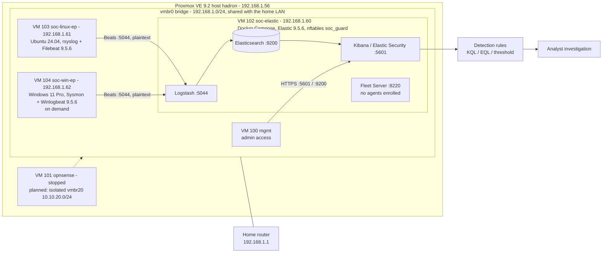
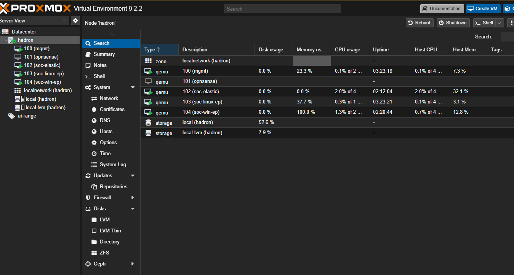

# 01 — Lab Architecture

> **Status: stack deployed 2026-11-15; Windows endpoint moved into Proxmox as VM 104 on
> 2026-11-17.** The Elastic stack and the Linux endpoint are running, and VM 103 now reaches
> Logstash on 5044 (see [Verification state](#verification-state)). Windows telemetry from
> VM 104 is not verified yet.
> Deployment files and procedures: [infrastructure/](../infrastructure/README.md).

## Components

| Component | Role | Where it runs |
|---|---|---|
| Proxmox VE 9.2 (`hadron`) | Virtualization host | Single physical host |
| Elasticsearch, Kibana, Fleet Server 9.5.6 | Storage, SIEM UI, agent management | VM 102 `soc-elastic`, Docker Compose in `/opt/elastic` |
| Logstash 9.5.6 | Beats input and index routing | VM 102, same Compose project (`docker-compose.override.yml`) |
| Linux endpoint | Linux telemetry source | VM 103 `soc-linux-ep`, Ubuntu 24.04, rsyslog, Filebeat 9.5.6 |
| Windows 11 endpoint | Windows telemetry source | VM 104 `soc-win-ep`, Windows 11 Pro, started on demand |
| Sysmon (SwiftOnSecurity config) | Process, network, and file telemetry | VM 104 |
| Winlogbeat 9.5.6 | Ships Windows Event Log and Sysmon events | VM 104 |
| Management VM | Admin access to Kibana and Elasticsearch | VM 100 `mgmt` |
| OPNsense | Planned firewall for an isolated lab network | VM 101 `opnsense`, stopped |

## Differences from the original project brief

| Brief | Actual lab | Effect on this project |
|---|---|---|
| Elastic Agent + Fleet | Beats (Winlogbeat, Filebeat) through Logstash; Fleet Server also runs but no agents are enrolled | ECS fields come from the Beats ingest pipelines, see [02](02-telemetry-configuration.md) |
| Windows 11 VM in Proxmox | VM 104 `soc-win-ep` (since 2026-11-17; the physical PC is no longer used) | Can be reverted to snapshot `clean-baseline` once that snapshot is taken |
| Ubuntu VM | Ubuntu 24.04 VM 103 | As planned |
| Isolated lab network | All guests share the `vmbr0` LAN bridge; VM 102 has a host allowlist (`soc_guard`) | Lab is **not** network-isolated today |
| Current Elastic Stack | Elastic 9.5.6 with security and TLS on | Detection engine prerequisites are met |

The stack on VM 102 was built on 2026-11-02 for an earlier phase of the lab and was reused
unchanged. This project added Logstash, a `logstash_writer` user, a `soc_analyst` login,
and the Filebeat index template and pipelines.

## Data flow

Solid arrows are live traffic. The dashed arrow is the planned move of the lab guests behind
OPNsense; until then every guest is reachable from the home LAN, and VM 102 relies on its
`soc_guard` allowlist.

Every Beat ships to Logstash, never directly to Elasticsearch, so index routing is applied in
one place. The Logstash pipeline has a single default output for every Beat (with a branch
that selects the Winlogbeat routing pipeline), so no Beat can be dropped by a missing branch.

## Network

| Item | Value | State |
|---|---|---|
| Bridge | `vmbr0`, shared with the home LAN | Verified (`/etc/network/interfaces`) |
| Addressing | Static: VM 102 192.168.1.60, VM 103 192.168.1.61 (cloud-init), VM 104 192.168.1.62 (set by `bootstrap.ps1`) | Verified for VMs 102 and 103 |
| VM 102 host firewall | nftables table `inet soc_guard` (`/etc/soc-guard.nft`): 9200, 5601 and 8220 from listed admin hosts; 5044 from the `beats` set (192.168.1.61, 192.168.1.62) | Configured |
| VM 103 → Logstash 5044 | `filebeat test output`: connection OK (2026-11-17) | Verified |
| VM 104 → Logstash 5044 | Not tested; SSH to VM 104 timed out (2026-11-17) | Not verified |
| Isolation between lab guests and LAN | None | Planned: vmbr20 / 10.10.20.0/24 |

## Verification state

| Claim | Evidence | State |
|---|---|---|
| VM 104 `soc-win-ep` is running | `qm list` shows it running (2026-11-17) | Verified |
| Sysmon and Winlogbeat 9.5.6 are running on VM 104 | SSH to VM 104 timed out (2026-11-17) | Not verified (the 2026-11-15 checks were on the retired physical PC) |
| VM 104 snapshot `clean-baseline` exists | `qm listsnapshot 104` shows no snapshot (2026-11-17) | **Not taken yet** |
| Elasticsearch 9.5.6 is up | `GET /` returns 9.5.6; `_cluster/health` green, 1 node (2026-11-15) | Verified |
| Kibana, Fleet Server, Logstash are healthy | `docker compose ps`: all healthy (2026-11-15) | Verified |
| Logstash listens on 5044 and authenticates to ES | Logstash log: "Elasticsearch version determined (9.5.6)", "Starting input listener 0.0.0.0:5044" | Verified |
| Elastic Security detection engine is usable | `POST /api/detection_engine/index` acknowledged; privileges API reports `has_encryption_key: true` | Verified |
| Filebeat template maps `source.ip` as `ip` | `_simulate_index/filebeat-9.5.6` | Verified |
| Linux endpoint Filebeat is configured | `filebeat test config` OK on VM 103 | Verified |
| Linux endpoint can reach Logstash | `filebeat test output`: connection OK (2026-11-17) | Verified |
| Windows events are indexed in `winlogbeat-*` | Not shipping yet | Not verified |
| Linux auth events are indexed in `filebeat-*` | Not shipping yet | Not verified |

## Screenshot

See the [screenshot checklist](screenshot-checklist.md).
