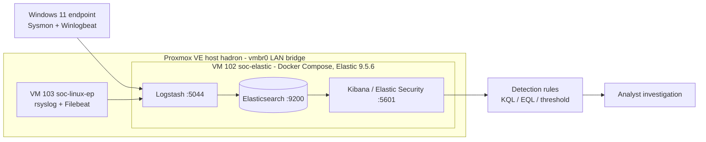

# 01 — Lab Architecture

> **Status: deployed 2026-11-15, endpoints not yet delivering.** The Elastic stack and the
> Linux endpoint are running and verified (see [Verification state](#verification-state)).
> Events don't arrive yet because the VM 102 host firewall drops Logstash traffic from
> endpoints, and the Windows endpoint still runs Winlogbeat 7.17.26.
> Deployment files and procedures: [infrastructure/](../infrastructure/README.md).

## Components

| Component | Role | Where it runs |
|---|---|---|
| Proxmox VE 9.2 (`hadron`) | Virtualization host | Single physical host |
| Elasticsearch, Kibana, Fleet Server 9.5.6 | Storage, SIEM UI, agent management | VM 102 `soc-elastic`, Docker Compose in `/opt/elastic` |
| Logstash 9.5.6 | Beats input and index routing | VM 102, same Compose project (`docker-compose.override.yml`) |
| Linux endpoint | Linux telemetry source | VM 103 `soc-linux-ep`, Ubuntu 24.04, rsyslog, Filebeat 9.5.6 |
| Windows 11 endpoint | Windows telemetry source | Windows 11 Pro host on the LAN |
| Sysmon (SwiftOnSecurity config) | Process, network, and file telemetry | Windows endpoint |
| Winlogbeat (7.17.26 installed, 9.5.6 required) | Ships Windows Event Log and Sysmon events | Windows endpoint |

## Differences from the original project brief

| Brief | Actual lab | Effect on this project |
|---|---|---|
| Elastic Agent + Fleet | Beats (Winlogbeat, Filebeat) through Logstash; Fleet Server also runs but no agents are enrolled | ECS fields come from the Beats ingest pipelines, see [02](02-telemetry-configuration.md) |
| Windows 11 VM in Proxmox | Windows 11 Pro host on the LAN | Not snapshot-revertible; simulations must stay benign |
| Ubuntu VM | Ubuntu 24.04 VM 103 | As planned |
| Isolated lab network | All guests share the `vmbr0` LAN bridge; VM 102 has a host allowlist (`soc_guard`) | Lab is **not** network-isolated today |
| Current Elastic Stack | Elastic 9.5.6 with security and TLS on | Detection engine prerequisites are met |

The stack on VM 102 was built on 2026-11-02 for an earlier phase of the lab and was reused
unchanged. This project added Logstash, a `logstash_writer` user, a `soc_analyst` login,
and the Filebeat index template and pipelines.

## Data flow

Every Beat ships to Logstash, never directly to Elasticsearch, so index routing is applied in
one place. The Logstash pipeline has a single default output for every Beat (with a branch
that selects the Winlogbeat routing pipeline), so no Beat can be dropped by a missing branch.

## Network

| Item | Value | State |
|---|---|---|
| Bridge | `vmbr0`, shared with the home LAN | Verified (`/etc/network/interfaces`) |
| Addressing | Static via cloud-init: VM 102 192.168.1.60, VM 103 192.168.1.61 | Verified |
| VM 102 host firewall | nftables table `inet soc_guard` (`/etc/soc-guard.nft`): 9200, 5601 and 8220 from listed admin hosts only | Verified |
| Endpoint → Logstash 5044 | Dropped by `soc_guard` | **Blocking**, change proposed |
| Isolation between lab guests and LAN | None | Planned: vmbr20 / 10.10.20.0/24 |

## Verification state

| Claim | Evidence | State |
|---|---|---|
| Sysmon service is running on the Windows endpoint | `Get-Service Sysmon64` returned Running (2026-11-15) | Verified |
| Winlogbeat service is running | `Get-Service winlogbeat` returned Running (2026-11-15) | Verified, but version 7.17.26 must be replaced |
| Elasticsearch 9.5.6 is up | `GET /` returns 9.5.6; `_cluster/health` green, 1 node (2026-11-15) | Verified |
| Kibana, Fleet Server, Logstash are healthy | `docker compose ps`: all healthy (2026-11-15) | Verified |
| Logstash listens on 5044 and authenticates to ES | Logstash log: "Elasticsearch version determined (9.5.6)", "Starting input listener 0.0.0.0:5044" | Verified |
| Elastic Security detection engine is usable | `POST /api/detection_engine/index` acknowledged; privileges API reports `has_encryption_key: true` | Verified |
| Filebeat template maps `source.ip` as `ip` | `_simulate_index/filebeat-9.5.6` | Verified |
| Linux endpoint Filebeat is configured | `filebeat test config` OK on VM 103 | Verified |
| Linux endpoint can reach Logstash | `filebeat test output`: dial timeout | **Failing**, firewall |
| Windows events are indexed in `winlogbeat-*` | Not shipping yet | Not verified |
| Linux auth events are indexed in `filebeat-*` | Not shipping yet | Not verified |

## Screenshot

Pending: `screenshots/architecture/01-proxmox-inventory.png` (Proxmox guest inventory). See the
[screenshot checklist](screenshot-checklist.md).
