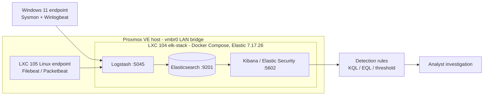

# 01 — Lab Architecture

> **Status: proposed architecture, partially verified.** The table under
> [Verification state](#verification-state) lists exactly what has been confirmed and how.
> Everything else is the intended design and is labeled as such.

## Components

| Component | Role | Where it runs |
|---|---|---|
| Proxmox VE | Virtualization host | Single physical host |
| ELK stack (Elasticsearch, Logstash, Kibana 7.17.26) | Storage, routing, SIEM UI | LXC 104 `elk-stack`, Docker Compose |
| Windows 11 endpoint | Windows telemetry source | Windows 11 Pro host on the lab LAN |
| Sysmon (SwiftOnSecurity config) | Process, network, and file telemetry | Windows endpoint |
| Winlogbeat 7.17.26 | Ships Windows Event Log and Sysmon events | Windows endpoint |
| Linux endpoint | Linux telemetry source | LXC 105 (Filebeat / Packetbeat / Metricbeat) |

## Differences from the original project brief

The brief for this project assumed Elastic Agent on a Windows 11 VM and an Ubuntu VM. The lab
that actually exists is different, and this repository documents the lab as it is:

| Brief | Actual lab | Effect on this project |
|---|---|---|
| Elastic Agent + Fleet | Beats (Winlogbeat, Filebeat) through Logstash | ECS fields depend on Beats module processors, see [02](02-telemetry-configuration.md) |
| Windows 11 VM in Proxmox | Windows 11 Pro host on the LAN | Not snapshot-revertible; simulations must stay benign |
| Ubuntu VM | Linux LXC container | Auth logging in a container needs checking before KQL-07 |
| Isolated lab network | All guests share the `vmbr0` LAN bridge | Lab is **not** network-isolated today |
| Current Elastic Stack | Elastic 7.17.26, no `xpack.security` | Detection engine prerequisites are not met yet, see [known issues](../PROJECT_STATUS.md#known-issues) |

Migrating to Elastic Agent or a newer stack is listed under future development. It is not a
prerequisite for the KQL and EQL exercises.

## Data flow

Every Beat ships to Logstash, never directly to Elasticsearch, so index routing is applied in
one place. Logstash drops events that match no branch of its output conditional without logging
an error, which makes a missing branch look like a silent sensor.

## Network

| Item | Value | State |
|---|---|---|
| Bridge | `vmbr0`, shared with the home LAN | From lab documentation |
| Addressing | DHCP from the LAN router, not static | From lab documentation |
| Remote access | WireGuard on the Proxmox host | From lab documentation |
| Isolation between lab guests and LAN | None | Proposed: dedicated bridge or VLAN |

Because addresses are DHCP-assigned, no IP addresses are recorded in this repository. Docs use
`<ELK_LXC_IP>`; obtain the current value on the Proxmox host with `pct exec 104 -- hostname -I`.

## Verification state

Checked on 2026-11-15 from the Windows endpoint, read-only.

| Claim | Evidence | State |
|---|---|---|
| Sysmon service is running on the Windows endpoint | `Get-Service Sysmon64` returned Running | Verified |
| Winlogbeat service is running | `Get-Service winlogbeat` returned Running | Verified |
| Winlogbeat collects Sysmon, Security, System, Application and outputs to Logstash on 5045 | Local `winlogbeat.yml` | Verified (configuration) |
| Winlogbeat is delivering events | Winlogbeat log shows repeated `Failed to connect` to the Logstash address | **Failing on 2026-11-15** |
| Elasticsearch and Kibana are reachable | HTTP requests to ports 9201 and 5602 timed out | **Not reachable on 2026-11-15** |
| Stack version is 7.17.26 | Lab `docker-compose.yml`; Winlogbeat install | Configuration only, running version not confirmed |
| Windows events are indexed in `winlogbeat-*` | No query possible | Not verified |
| Linux auth events are indexed in `filebeat-*` | No query possible | Not verified |
| Elastic Security detection engine is usable | No query possible | Not verified |

## Screenshot

Pending: `screenshots/architecture/01-proxmox-inventory.png` (Proxmox guest inventory). See the
[screenshot checklist](screenshot-checklist.md).
