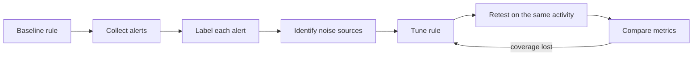

# 05 — Alert Tuning

The method for reducing alert noise without losing detection coverage, and the plan for the
first experiment, DET-001. **No experiment has been run. There are no results yet.**

## Workflow



1. **Baseline.** Deploy the rule in its simplest form. Record its exact configuration.
2. **Collect alerts.** Run it over a window that contains both normal activity and scripted simulations.
3. **Label results.** Mark every alert true positive or false positive against the ground-truth record.
4. **Identify noise.** Group false positives by cause: account, host, process, time of day.
5. **Tune.** Change one thing at a time so its effect can be measured.
6. **Retest.** Replay the same simulations. A tuned rule is only comparable to baseline on the same activity.
7. **Compare metrics.** Accept the change only if precision improves and recall does not drop.

## Concepts

| Term | Meaning in this project |
|---|---|
| True positive (TP) | An alert caused by a simulated attack activity in the ground-truth record |
| False positive (FP) | An alert caused by benign activity |
| False negative (FN) | A simulated attack activity that produced no alert |
| Precision | TP / (TP + FP). Of the alerts raised, how many were worth an analyst's time |
| Recall | Detected attack activities / all attack activities. How much of the attack was caught |
| Threshold tuning | Changing the count or window that turns events into an alert |
| Rule exception | Excluding a specific, verified-benign value (an account, host, or process) from a rule |
| Alert suppression | Grouping repeated alerts for the same entity into one, without changing what matches |
| Risk scoring | Assigning severity and a 0-100 risk score so analysts triage the right alerts first |
| Detection coverage regression | A tuning change that silently stops a rule catching something it used to catch |

Two points that are easy to get wrong:

- **An alert is not an incident.** A rule firing shows that events matched a pattern. Whether an attack occurred is an analyst's finding, made from the evidence.
- **False negatives cannot be counted from alerts.** They are only measurable against a record of what was actually done, which is why every simulation is logged before it runs.

Precision is counted per alert. Recall is counted per ground-truth activity, because one
activity can raise several alerts and counting alerts would overstate coverage.

## Experiment DET-001

**Title:** Reducing Authentication Alert Noise Without Losing Detection Coverage

**Objective:** Determine how threshold changes, exceptions, and alert grouping affect alert
volume and detection quality for repeated authentication failures.

**Rule under test:** [DET-001](detections/DET-001-auth-failure-threshold.md), draft definition
in [detection-rules/threshold/](../detection-rules/threshold/).

### Safety constraints

- Authentication is attempted only against **this lab's own Windows endpoint**, using local accounts created for the test whose names start with `det001-`.
- No attempts against any other system, account, or network.
- Windows 11 locks an account after 10 failed attempts by default. Keep bursts below the lockout threshold or use a separate test account per burst.
- Remove the test accounts when the experiment ends.

### Ground truth

Every activity is written to a ground-truth CSV **before or as it runs**, using
[templates/ground-truth-template.csv](../templates/ground-truth-template.csv). The helper
[scripts/Invoke-Det001AuthSimulation.ps1](../scripts/Invoke-Det001AuthSimulation.ps1) generates
failed logons against a `det001-` account and appends the row itself.

Planned activity set (adjust and record what is actually run):

| Activity | Class | Description |
|---|---|---|
| Rapid guessing | `malicious_sim` | 8 failures in under a minute against one test account |
| Slow guessing | `malicious_sim` | 6 failures spread over 4 minutes |
| Low and slow | `malicious_sim` | 4 failures spread over 20 minutes (expected to test the limits of a threshold) |
| Mistyped password | `benign` | 1 or 2 failures followed by a success |
| Stale credential | `benign` | A scheduled task or mapped drive retrying an old password |

### Experiment stages

| Stage | Change from previous | What it tests |
|---|---|---|
| E1 Baseline | Threshold 3 failures per host in 5 minutes | Raw alert volume |
| E2 Threshold adjustment | Raise count; group by `host.name` and `user.name` | Effect of count and grouping on FP and FN |
| E3 Narrow exception | Exclude one verified-benign account or source | FP removed without widening the blind spot |
| E4 Alert suppression | Group alerts per account per window | Volume change with identical matching |
| E5 Regression test | Replay every `malicious_sim` activity against the final rule | Coverage preserved |

The starting values above are a plan, not a finding. Record the real configuration of each
stage in the results file.

### Recording and calculating

For each stage, record: rule configuration, test conditions, matching events, alerts, TP, FP,
FN, precision, recall, and screenshots. Results go in
[results/metrics/DET-001-results.md](../results/metrics/DET-001-results.md).

Label exported alerts with [templates/alert-labels-template.csv](../templates/alert-labels-template.csv),
then calculate:

```
python scripts/calc_metrics.py --ground-truth results/baseline/ground-truth.csv --alerts results/baseline/alerts-labeled.csv
```

### Results

| Metric | Baseline | Tuned |
|---|---|---|
| Total alerts | Pending | Pending |
| True positives | Pending | Pending |
| False positives | Pending | Pending |
| False negatives | Pending | Pending |
| Precision | Pending | Pending |
| Recall | Pending | Pending |

### Blockers

The Elastic Security detection engine in 7.17 requires Elasticsearch security to be enabled
and a Kibana encryption key. The lab stack has neither, so rules cannot be created until that
is changed. See [known issues](../PROJECT_STATUS.md#known-issues). The threshold logic can
still be explored beforehand with a Discover histogram or an aggregation query.

Screenshots pending: `09-baseline-alerts.png`, `10-tuned-alerts.png`, `12-detection-metrics.png`.
